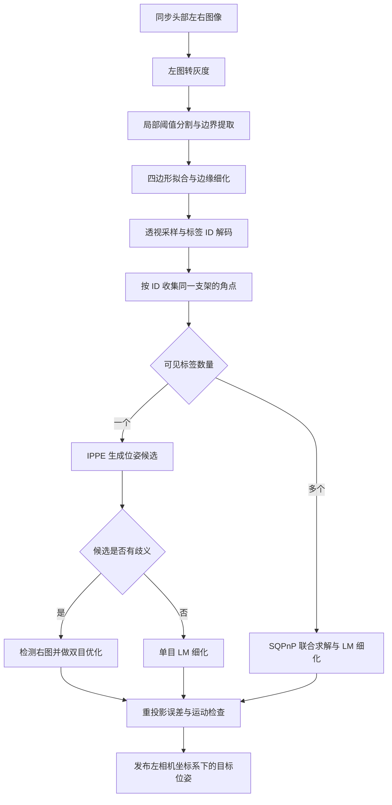

# Marker 检测与位姿估计算法

本文整理 TinyNav UMI 的 marker 算法：AprilTag 3 从图像中识别标签 ID 和四个角点，OpenCV PnP 与 Ceres 再估计支架的位置和朝向。
说明依据 `tinynav-umi` 提交 `954abdc7f42e5f912f201727fcb8ca26a0ac1e2d`；下列行号对应该版本。

## 核心算法的绝对路径

**项目核心实现集中在这个文件：**

```text
/home/xuran/projects/umi_marker/tinynav-umi/tinynav_ros/src/marker_rig_pose_node.hpp
```

| 阶段 | 函数或调用 | 源码定位 |
| --- | --- | --- |
| 图像同步 | `subscribe_images()` / `synced_callback()` | [191 行][sync] / [297 行][callback] |
| 加载标签尺寸与安装外参 | `load_marker_config()` | [259 行][config-loader] |
| 相机内参、畸变和基线 | `camera_info_callback()` | [369 行][camera-info] |
| 灰度处理、检测与筛选 | `detect()` | [378 行][detect] |
| 调用 AprilTag 底层检测器 | `apriltag_detector_detect()` | [399 行][apriltag-call] |
| 重投影误差 | `reprojection_error()` | [434 行][reprojection] |
| 双目重投影残差与优化 | `StereoResidual` / `optimize_stereo()` | [493 行][stereo-residual] / [515 行][stereo-optimize] |
| 单标签位姿候选 | `square_candidates()` | [567 行][candidates] |
| 单标签消歧、多标签联合求解 | `solve_rig()` | [596 行][solve] |
| 运动筛选与位姿发布 | `process_pair()` | [756 行][process] |

节点启动入口的绝对路径如下；其中 `main()` 创建并运行 `MarkerRigPoseNode`：

```text
/home/xuran/projects/umi_marker/tinynav-umi/tinynav_ros/src/marker_rig_pose_node.cpp
```

标签几何、检测参数及话题配置的绝对路径：

```text
/home/xuran/projects/umi_marker/tinynav-umi/tinynav_ros/configs/UMI_v3.json
```

AprilTag 的阈值分割、四边形拟合和解码由外部 `libapriltag` 实现，当前项目未包含其 `.c` 源码。
因此，上面的绝对路径定位项目的检测调用与位姿算法；底层检测算法的官方源码链接列在文末。
依赖声明见 [CMakeLists.txt:44][cmake]，实际部署所用库版本需在对应构建环境中核实。

## 总体流程



没有配置内的标签可见、求解失败或质量检查未通过时，该支架在这一帧不发布位姿。

## 1. 图像预处理与同步

节点通过 `ApproximateTime` 同步左右图像，当前同步容差为 `0.005 s`。标定信息到齐后，先对左图执行检测。
NV12 直接使用 Y 亮度平面，`mono8` / `8UC1` 直接作为灰度图，RGB/BGR 转换为灰度图。
图像按检测倍率缩放；输出角点再除以相同倍率，还原到原图坐标，以便使用原图内参求解。

当前 `UMI_v3.json` 的 `image_scale_override=1.0` 覆盖了 `marker_geometry.image_scale=2.0`。
按该文件加载节点参数时，有效倍率是 **1.0**；运行时额外的参数覆盖可能改变此值。

## 2. 寻找候选四边形

AprilTag 使用局部亮度范围建立阈值，可概括为 `T = (I_max + I_min) / 2`，把高对比度区域分为黑、白两类。
随后计算连通区域，将相邻黑白区域之间的边界点聚成候选边界。

边界点按环绕顺序排列并分为四段，各段拟合直线，相邻直线求交得到四个角点。
面积、拟合误差和形状检查会淘汰不合格候选。平面正方形斜拍后可以变成一般四边形，因此不要求候选在图像中仍是正方形。

启用 `refine_edges` 时，检测器沿候选边的法向搜索灰度变化，重新拟合边线和交点，以提高角点精度。
四边形检测见官方 [apriltag_quad_thresh.c][quad-source]，边缘细化见 [apriltag.c][detector-source]。

## 3. 透视采样、解码与筛选

四个角点确定标签平面到图像的单应矩阵 `H`。检测器通过 `H` 找到各编码格中心在原图的位置，采样亮度，并按标签周围的黑白亮度模型判定每一位。
`tag16h5` 使用 4×4 个编码格、共 16 位；码族最小汉明距离为 5，定义见官方 [tag16h5.c][family-source]。

解码器比较采样编码与码表中的合法编码，并尝试四种旋转方向。
汉明距离表示两串编码不同的位数；匹配成功后得到标签 ID、方向和角点顺序。
`decision_margin` 衡量编码格亮度离黑白判定阈值的距离，不是概率。解码过程见 [apriltag.c][detector-source]。

项目的 `detect()` 执行以下处理：

- 要求 `hamming ≤ 1`、`decision_margin ≥ 20`。
- 同一 ID 出现多个检测结果时，保留 `decision_margin` 最大者。
- 将角点重排为标签方向下的左上、右上、右下、左下，并还原到原图像素坐标。
- `solve_rig()` 只收集配置中的 ID：左手支架为 `0–3`，右手支架为 `4–7`。

此阶段的结果是二维观测：`ID → 四个角点 + 解码质量`。

## 4. 从角点求三维位姿

配置提供标签边长 `0.0525 m`、每张标签在支架中的安装变换 `rig_T_marker`，以及支架到输出目标的变换 `rig_T_target`。
因此，标签角点在支架坐标系中的三维坐标已知；图像中对应的二维角点来自检测器。

PnP 寻找旋转 `R` 和平移 `t`，让已知三维角点投影后尽量贴合检测到的像素位置：

```text
minimize Σᵢ || project(K, D, R·Pᵢ + t) − pᵢ ||²
```

`Pᵢ` 是三维角点，`pᵢ` 是像素角点，`K`、`D` 是相机内参和畸变参数。
两者之间的像素差称为重投影误差。标签真实尺寸提供距离尺度，透视形变提供朝向约束。

### 单标签：IPPE 候选与双目消歧

`square_candidates()` 调用 `solvePnPGeneric(..., SOLVEPNP_IPPE)`，去除深度非正的解，再按左图重投影误差排序。
平面标签可能存在两个投影相近但朝向不同的候选。当前同时满足以下条件时进入双目分支：

- 两个候选的左图误差差值不超过 `0.25 px`。
- 两个候选的旋转差至少为 `10°`。

此时才检测右图中的同一 ID；右图未检出则放弃该帧位姿。
对每个候选，Ceres 联合最小化左右图四个角点的重投影误差，选择优化后误差最小的结果。
无歧义时，在左图上调用 `solvePnPRefineLM()` 细化结果。

双目残差采用校正后的水平基线模型：`u_L = fx·X/Z + cx`，`u_R = fx·(X−b)/Z + cx`，左右共用 `v = fy·Y/Z + cy`。
代码从 `CameraInfo` 取得 `b = −P[3]/K[0]`；该分支要求输入图像和标定与此模型一致。

### 多标签：联合求解支架位姿

将各标签四个角点通过 `rig_T_marker` 变换到同一支架坐标系，汇集所有 3D–2D 对应点。
随后调用 `solvePnP(..., SOLVEPNP_SQPNP)` 和 `solvePnPRefineLM()`，得到 `camera_T_rig`。

启用异常标签剔除时，代码比较单标签估计与联合估计的平移偏差，超过 `0.05 m` 时尝试剔除最偏离的标签并重新求解。
这一分支使用左图角点。

## 5. 结果检查与坐标系

重投影误差使用角点二维距离的均方根：单目为四个或多个角点，双目为左右两组共八个角点。
求解结果需要满足 `max_reprojection_error_px=1.0`。

输出变换为：

```text
camera_T_target = camera_T_rig × rig_T_target
```

`parent_T_child` 将 child 坐标变换到 parent 坐标。当前两个 `rig_T_target` 都是单位矩阵。
节点还比较当前候选与上次接受位姿，超过 `1.5 m/s` 或 `360°/s` 时丢弃候选。
这些速度在相机坐标系中计算，反映目标相对相机的运动。

最终通过 `/arm/left/pose_state` 和 `/arm/right/pose_state` 发布 `PoseStamped`。
位姿表达在成像的左相机光学坐标系中，frame_id 来自配置的左相机 `CameraInfo`；此节点的 marker 位姿求解不使用头部 VIO 里程计。

## 当前主要参数

以下为当前配置加载后、未额外覆盖时的值。标为“默认”的参数未写入 JSON，取自节点声明。

| 参数 | 值 | 作用 |
| --- | --- | --- |
| `apriltag_family` | `tag16h5` | 标签码族 |
| `marker_size_m` | `0.0525` | 配置中各标签边长，单位 m |
| `image_scale` / `image_scale_override` | `2.0` / `1.0` | 当前有效检测倍率 1.0 |
| `quad_decimate` / `quad_sigma` | `1.0` / `0.0` | 四边形检测缩放与预处理平滑参数 |
| `refine_edges` / `decode_sharpening` | `true` / `0.25` | 边缘细化与编码采样锐化 |
| `max_hamming` / `min_decision_margin` | `1` / `20.0` | 解码接受条件 |
| `stereo_sync_slop_sec` | `0.005` | 左右图像同步容差，单位 s |
| `max_left_error_gap_px` / `min_candidate_rotation_deg` | `0.25` / `10.0` | 触发单标签双目消歧的条件 |
| `max_reprojection_error_px` | `1.0` | 最大重投影 RMS，单位 px |
| `enable_outlier_rejection` / `max_single_marker_deviation_m` | `true` / `0.05`（默认） | 多标签异常检测 |
| `enable_velocity_gate` | `true`（默认） | 开启运动幅度检查 |
| `max_linear_speed_mps` / `max_angular_speed_degps` | `1.5` / `360.0` | 相对运动速度上限 |

## AprilTag 底层源码索引

以下是官方仓库的源码链接，供阅读检测算法；链接指向上游 `master`，不能据此认定本机安装库的具体版本。

| 官方文件 | 关键函数 | 内容 |
| --- | --- | --- |
| [apriltag_quad_thresh.c][quad-source] | `threshold`、`connected_components`、`gradient_clusters`、`fit_quad` | 局部阈值、连通区域、边界聚类与四边形拟合 |
| [apriltag.c][detector-source] | `apriltag_detector_detect`、`refine_edges`、`quad_decode`、`quick_decode_codeword` | 检测入口、角点细化、透视采样与码表匹配 |
| [tag16h5.c][family-source] | `tag16h5_create` | 合法码字、16 位采样位置及码族参数 |

[sync]: /home/xuran/projects/umi_marker/tinynav-umi/tinynav_ros/src/marker_rig_pose_node.hpp:191
[callback]: /home/xuran/projects/umi_marker/tinynav-umi/tinynav_ros/src/marker_rig_pose_node.hpp:297
[config-loader]: /home/xuran/projects/umi_marker/tinynav-umi/tinynav_ros/src/marker_rig_pose_node.hpp:259
[camera-info]: /home/xuran/projects/umi_marker/tinynav-umi/tinynav_ros/src/marker_rig_pose_node.hpp:369
[detect]: /home/xuran/projects/umi_marker/tinynav-umi/tinynav_ros/src/marker_rig_pose_node.hpp:378
[apriltag-call]: /home/xuran/projects/umi_marker/tinynav-umi/tinynav_ros/src/marker_rig_pose_node.hpp:399
[reprojection]: /home/xuran/projects/umi_marker/tinynav-umi/tinynav_ros/src/marker_rig_pose_node.hpp:434
[stereo-residual]: /home/xuran/projects/umi_marker/tinynav-umi/tinynav_ros/src/marker_rig_pose_node.hpp:493
[stereo-optimize]: /home/xuran/projects/umi_marker/tinynav-umi/tinynav_ros/src/marker_rig_pose_node.hpp:515
[candidates]: /home/xuran/projects/umi_marker/tinynav-umi/tinynav_ros/src/marker_rig_pose_node.hpp:567
[solve]: /home/xuran/projects/umi_marker/tinynav-umi/tinynav_ros/src/marker_rig_pose_node.hpp:596
[process]: /home/xuran/projects/umi_marker/tinynav-umi/tinynav_ros/src/marker_rig_pose_node.hpp:756
[cmake]: /home/xuran/projects/umi_marker/tinynav-umi/tinynav_ros/CMakeLists.txt:44
[quad-source]: https://github.com/AprilRobotics/apriltag/blob/master/apriltag_quad_thresh.c
[detector-source]: https://github.com/AprilRobotics/apriltag/blob/master/apriltag.c
[family-source]: https://github.com/AprilRobotics/apriltag/blob/master/tag16h5.c
